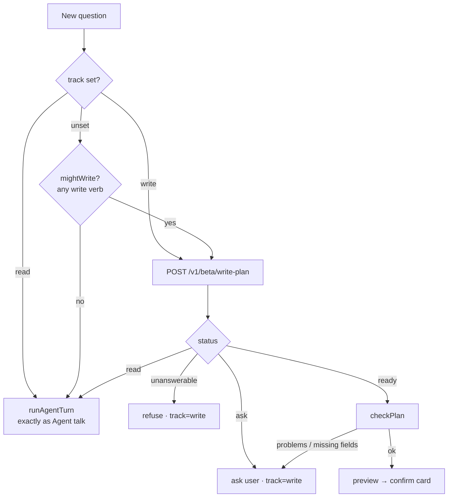
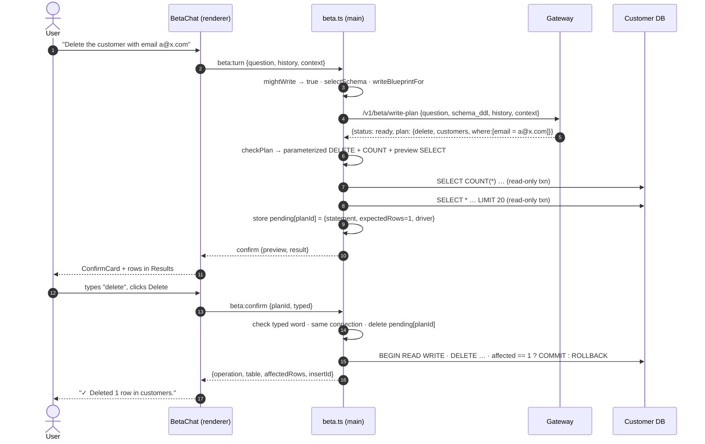

# Beta mode: architecture

Beta is a fourth tab in the desktop app. It answers questions like Agent talk does, and it can also **insert, update, and delete** rows, with the user confirming each change before it runs.

The other three tabs (Ask in English, Agent talk, Write SQL) are unchanged. They still run every query in a read-only transaction, and the gateway's AST guardrail still rejects any write that the model writes as SQL. Beta adds a separate path for writes and leaves those controls alone.

> **Status: beta.** It is built for trying things on non-critical data. See [Limitations](#limitations).

---

## Contents

1. [Guarantees](#guarantees)
2. [Components](#components)
3. [How a turn is routed](#how-a-turn-is-routed)
4. [The write path, end to end](#the-write-path-end-to-end)
5. [Gateway: the write planner](#gateway-the-write-planner)
6. [Client: validating a plan and building the SQL](#client-validating-a-plan-and-building-the-sql)
7. [Preview and confirmation](#preview-and-confirmation)
8. [Execution](#execution)
9. [Schema metadata Beta depends on](#schema-metadata-beta-depends-on)
10. [Privacy: what leaves the machine](#privacy-what-leaves-the-machine)
11. [Error codes](#error-codes)
12. [Limits and configuration](#limits-and-configuration)
13. [Limitations](#limitations)
14. [Testing](#testing)
15. [Changing Beta safely](#changing-beta-safely)

---

## Guarantees

Every design decision below supports one of these. If a change weakens one, treat it as a security change.

| # | Guarantee | Enforced by |
|---|---|---|
| G1 | **The model never writes SQL for a write.** It returns a structured plan. The SQL is built by local, deterministic code. | `WritePlan` schema (gateway), `checkPlan` (client) |
| G2 | **Every identifier is real.** Tables and columns are resolved against the live schema snapshot. Unknown names are rejected and never quoted through. | `checkPlan` |
| G3 | **Every value fits its column.** Values are type-checked and coerced per column type before binding. | `coerceValue` |
| G4 | **Values cannot change the statement's shape.** Values are bound parameters. Identifiers are quoted. Operators come from a fixed allowlist. | `writePlan.ts` builders, driver parameter binding |
| G5 | **No unbounded update or delete.** Both require a `WHERE`, may touch at most 100 rows, and must match at least one. | gateway parser, `checkPlan`, `runBetaTurn` |
| G6 | **Nothing changes without confirmation.** The user sees the rows affected and confirms. A delete also requires typing `delete`. | `runBetaTurn`, `confirmWrite`, `ConfirmCard` |
| G7 | **What runs is exactly what was previewed.** The statement stays in the main process under a single-use id. The renderer can only confirm or cancel that id. | `pending` map in `beta.ts` |
| G8 | **It commits only if the row count still matches the preview.** If the data changed since the preview, the write rolls back. | `Driver.write` |
| G9 | **Other tabs stay read-only.** `execute`, `explain`, and `query` keep their read-only transactions. `write` is called only from `confirmWrite`. | `driver.ts` |
| G10 | **No row data reaches the gateway**, for writes or reads. | request schemas, `test_no_row_data.py` |

---

## Components

```mermaid
flowchart LR
  subgraph Renderer["Renderer (no Node access)"]
    BC[BetaChat.tsx<br/>thread · ConfirmCard]
    DB[Dashboard.tsx<br/>Beta tab · Results · Diagnostics]
  end
  subgraph Main["Electron main process"]
    IPC[ipc.ts<br/>beta:turn · beta:confirm · beta:cancel]
    BT[beta.ts<br/>routing · preview · pending writes]
    WP[db/writePlan.ts<br/>validate · coerce · build SQL]
    AG[agent.ts<br/>read path, unchanged]
    DR[db/driver.ts<br/>query · write]
    GW[gateway.ts<br/>writePlan()]
  end
  subgraph Gateway["server-gateway (FastAPI)"]
    R[routers/beta.py<br/>POST /v1/beta/write-plan]
    E[engines<br/>plan_write()]
    P[write_plan_output.py<br/>parse · validate]
  end
  DBMS[(Customer DB)]

  BC -- window.api.beta --> IPC --> BT
  BT --> AG
  BT --> WP
  BT --> GW --> R --> E --> P
  BT --> DR --> DBMS
```

| Layer | File | Responsibility |
|---|---|---|
| UI | `client-desktop/src/renderer/src/components/BetaChat.tsx` | Conversation thread, `ConfirmCard`, cancelling a preview the user walks away from |
| UI | `client-desktop/src/renderer/src/components/Dashboard.tsx` | `beta` mode, amber tab, error titles for `WRITE_*` codes |
| Bridge | `client-desktop/src/preload/index.ts`, `src/shared/types.ts` | `window.api.beta.{turn, confirm, cancel}` and the `Beta*` / `Write*` types |
| Main | `client-desktop/src/main/ipc.ts` | Registers the three `beta:*` handlers |
| Main | `client-desktop/src/main/beta.ts` | Routes turns, previews writes, holds pending writes, confirms or cancels |
| Main | `client-desktop/src/main/db/writePlan.ts` | Pure functions: `checkPlan`, `coerceValue`, `writeBlueprintFor`, `followUpMessage` |
| Main | `client-desktop/src/main/db/driver.ts` | `query()` (parameterized read-only) and `write()` (the only write path) |
| Gateway | `server-gateway/app/routers/beta.py` | `POST /v1/beta/write-plan`, metering |
| Gateway | `server-gateway/app/services/prompts.py` | `WRITE_PLANNER_SYSTEM_INSTRUCTION`, `build_write_plan_prompt` |
| Gateway | `server-gateway/app/services/write_plan_output.py` | `parse_write_plan`: reply text → `WritePlanResponse` |
| Gateway | `server-gateway/app/services/{llm,groq}.py` | `plan_write()` on Gemini and Groq. The Ollama engine inherits Groq's. |
| Gateway | `server-gateway/app/schemas.py` | `WritePlan`, `WhereCondition`, `WritePlanRequest`, `WritePlanResponse` |

---

## How a turn is routed

Each exchange in the Beta thread has a **track**: `read` or `write`. The track is unset until the first reply decides it. After that, every later turn in the exchange stays on the same track.



**`mightWrite(question)`** (`beta.ts`) is a deterministic gate that runs before any model call. It splits the question into words and checks them against a fixed set of verbs that can mean changing data: `add, insert, create, update, change, set, delete, remove, mark, …`. Words must match exactly, so "cancelled orders" and "new customers" don't trigger it.

- **No write verb:** the question goes straight to Agent talk, with no planner call and no extra metering. This exists because a small local model (qwen2.5:3b) was seen sending "how many customers are in Punjab?" down the write path.
- **A write verb:** the planner still decides. It can return `read` for questions like "show the price change by month".

**Context.** Earlier finished exchanges are passed as `PriorExchange[]`, the most recent 3 (`CONTEXT_WINDOW`), so follow-ups like "now change her phone" can be resolved.

- A finished read contributes its resolved question.
- A finished write contributes the plan's `summary`. That summary is built from the plan, so it contains only values the user typed, never rows read back from the database.

---

## The write path, end to end



An insert follows the same path without the COUNT and preview queries. Its preview is the row about to be inserted, and `expectedRows` is 1.

---

## Gateway: the write planner

### Endpoint

`POST /v1/beta/write-plan`. Requires authentication.

```jsonc
// Request: WritePlanRequest
{
  "question": "add a customer named Asha Rao",   // 1–2000 chars
  "schema_ddl": ["CREATE TABLE customers (...)"], // 1–80 entries, from writeBlueprintFor
  "history": [{ "role": "assistant", "content": "..." }, { "role": "user", "content": "..." }], // ≤ 24
  "context": [{ "question": "...", "resolved_question": "..." }] // ≤ 6
}
```

```jsonc
// Response: WritePlanResponse
{ "status": "read" }
{ "status": "ask", "message": "What is Asha's email address?", "options": [] }
{ "status": "unanswerable", "message": "..." }
{ "status": "ready", "plan": {
    "operation": "update",                 // insert | update | delete
    "table": "customers",
    "values": { "phone": "+91 98765 43210" }, // insert row / update SET; unused for delete
    "where": [ { "column": "email", "op": "=", "value": "asha@example.com" } ] // ANDed
} }
```

`op` is one of `= != < <= > >= like in "is null" "is not null"`. The Pydantic `Literal` rejects anything else, so an operator like `OR 1=1 --` fails validation and never reaches the client.

### Prompt (`WRITE_PLANNER_SYSTEM_INSTRUCTION`)

The rules that matter most:

- **Classify first.** If the user only wants to see data, reply `{"status": "read"}`.
- **Never invent a value.** Use only what the user typed. `TODAY` is given in the prompt, so "today" resolves without a guess.
- **Insert:** ask for every required field that's missing, all in one question. Don't ask for optional ones. Never include a `GENERATED` column.
- **Update and delete:** need a condition. Ask if it's missing or vague. Never widen what the user asked for.
- **Scope:** only AND-ed conditions on the target table. Anything more is explained to the user and refused.

The prompt's blueprint comes from `writeBlueprintFor` (client), not `blueprintFor`. It adds `GENERATED` and `DEFAULT` markers to columns, and `CREATE VIEW` for views. The read pipeline's prompt is unchanged.

### Parsing (`parse_write_plan`)

Unlike the clarifier, the write parser **never guesses**. An unusable reply becomes an `ask` ("could you say it again, a bit more specifically?"), because a write built from a misread plan can't be undone.

| Model reply | Result |
|---|---|
| Not JSON | `ask`: rephrase |
| `ready`, plan fails schema validation | `ask`: rephrase |
| `ready`, update or delete without `where` | `ask`: "Which rows should this … apply to?" |
| `ask` after the turn budget is spent | `unanswerable`: start again with all details |
| Unknown `status` | `ask`: rephrase |

JSON extraction is shared with the clarifier (`clarify_output._extract_object`). If parsing fails, it removes a stray `[]` straight after a closing brace or bracket, then decodes the first complete object. This handles a qwen2.5:3b quirk seen in testing. Replies that already parse are unaffected.

### Metering

- The **opening** turn of a write conversation (`history` empty, status `ask` or `ready`) is metered once, like a fresh `/v1/translate`.
- Follow-up turns are free, bounded by `max_write_turns`.
- A turn that returns `read` is **not** metered here. The client then runs it through the normal pipeline, which meters it there.

---

## Client: validating a plan and building the SQL

`checkPlan(plan, blueprint)` in `db/writePlan.ts` is pure: no I/O, no throwing for a bad plan. It returns either `{ ok: true, write: BuiltWrite }` or `{ ok: false, problems, missing }`. The second form becomes the assistant's next question, via `followUpMessage`.

### Resolution

- **Table:** case-insensitive exact match. If there's no match, it's refused. A view is refused with "a view can't be changed directly".
- **Columns:** case-insensitive exact match. Unknown columns become problems.
- **Generated columns:**
  - Insert: dropped, with a note shown to the user.
  - Update: refused.

### Required fields (insert)

A column is required when it is `NOT NULL`, has no default, is not generated, and has no value yet. A value that was given but invalid counts as a problem, not as missing, so the user is told what's wrong with it rather than asked for it again.

```
I still need: email (text), joined on (date, YYYY-MM-DD).
```

### Type coercion (`coerceValue`)

The collation suffix (`COLLATE …`) is stripped before matching.

| Column type | Accepts | Bound as | Rejects |
|---|---|---|---|
| `TINYINT(1)`, `BOOLEAN`, `BOOL`, `BIT(1)` | true/false, yes/no, y/n, 1/0, on/off | MySQL `1`/`0`, Postgres `true`/`false` | anything else |
| `TINYINT … BIGINT`, `SERIAL` family | whole numbers | number (string past 2⁵³) | decimals, words, out of range, negative if `UNSIGNED` |
| `DECIMAL(p,s)`, `NUMERIC` | decimal text | **string**, to keep it exact | more than `s` decimal places, more than `p−s` integer digits |
| `FLOAT`, `DOUBLE`, `REAL` | numbers | number | non-numeric |
| `DATE` | `YYYY-M-D` | `YYYY-MM-DD` | impossible dates (e.g. Feb 30) |
| `DATETIME`, `TIMESTAMP` | date, or date + `HH:MM[:SS]` | `YYYY-MM-DD HH:MM:SS` | invalid date or time |
| `TIME` | `HH:MM[:SS]` | `HH:MM:SS` | out of range |
| `ENUM('a','b')` | case-insensitive member | the canonical member | non-members (the error lists the allowed values) |
| `JSON` | valid JSON text | string | invalid JSON |
| `UUID` | canonical UUID | string | anything else |
| `VARCHAR(n)`, `CHAR(n)`, … | text up to `n` characters | string | longer than `n` |
| anything else | text | string | nothing |

**Empty values:**
- `null`, or an empty string for a non-text column, means "empty".
- Allowed only on nullable columns. Otherwise the error is "can't be left empty".

### Conditions

- **Allowlisted operators.** `!=` is emitted as `<>`.
- **`= null` / `!= null`** are rewritten to `IS NULL` / `IS NOT NULL`, because `= NULL` never matches in SQL.
- **`in`** coerces each element. An empty list is a problem.
- **`like`** binds the pattern as a string.
- **Other values** are coerced against the condition's column, so `id = "abc"` is rejected.

### Built statements

The same builder emits both the statement that runs and the one that's displayed. The only difference is the bind function: a placeholder versus a SQL literal with `'` doubled.

```sql
-- MySQL (runs)
UPDATE `customers` SET `phone` = ? WHERE `email` = ?
-- Postgres (runs); placeholders are numbered across SET and WHERE
UPDATE "customers" SET "phone" = $1, "first_name" = $2 WHERE "id" IN ($3, $4)
-- Postgres insert asks for a single-column primary key back
INSERT INTO "customers" ("first_name", "email") VALUES ($1, $2) RETURNING "id"

-- Preview queries reuse the identical WHERE, with their own parameter list
SELECT COUNT(*) AS affected FROM `customers` WHERE `email` = ?
SELECT * FROM `customers` WHERE `email` = ? LIMIT 20
```

`displaySql` is **never executed**. It exists only for the "Show SQL" disclosure on the confirm card and for the Diagnostics panel.

---

## Preview and confirmation

### Preview (`runBetaTurn`, after `checkPlan` succeeds)

**Insert:**
- The preview is the new row.
- `affectedRows = 1`.

**Update or delete:**
- `COUNT(*)` runs through `driver.query`, in a read-only transaction.
- **0 rows:** returns `ask` ("No customers rows match that…"). Nothing is offered for confirmation.
- **More than `MAX_WRITE_ROWS` (100):** returns `ask` with a request to narrow it down.
- **Otherwise:** samples up to `PREVIEW_ROWS` (20) rows. A note is added when there are more than 20.

The preview is returned as `WritePreview` for the card, plus a `PipelineResult` so the shared Results and Diagnostics panels show the affected rows and the SQL. Preview rows are read from the user's database and shown locally. They never leave the machine.

### Pending writes

```ts
pending: Map<planId, {
  write: BuiltWrite;       // the parameterized statement
  expectedRows: number;    // from the preview
  driver: Driver;          // connection identity at preview time
  confirmWord: "delete" | null;
  createdAt: number;
}>
```

- **Stored only in the main process.** The renderer receives the `planId` and nothing it could edit.
- **Expiry:** entries expire after `PLAN_TTL_MS` (10 min). Expired entries are swept on each turn and each confirm.
- **Single use:** the entry is removed **before** the statement runs, so a double-click can't run it twice.
- **Abandoned previews are cancelled.** Asking a new question or starting a new conversation calls `beta:cancel`, so the stale card can't be confirmed later.

### `confirmWrite(planId, typed)` checks, in order

1. **The entry exists and hasn't expired.** Otherwise: `WRITE_EXPIRED`.
2. **Same connection as at preview time.** `requireActive().driver === entry.driver`. Otherwise: `WRITE_EXPIRED`, because a reconnect means the preview described a different database.
3. **Delete only: the typed word matches.** It's trimmed and case-insensitive. Otherwise: `WRITE_NOT_CONFIRMED`, and the entry is kept so the user can retry.
4. **Remove the entry, then run `driver.write`.**

The UI mirrors check 3 by keeping the Delete button disabled until the word is typed. The main process enforces it independently.

---

## Execution

`Driver.write(sql, params, expectedRows)` is the only method in the app that opens a read-write transaction.

```
BEGIN / START TRANSACTION READ WRITE
  run the one parameterized statement
  if affected rows ≠ expectedRows → throw RowCountMismatchError → ROLLBACK
  COMMIT
on any error → ROLLBACK, rethrow
```

**MySQL:**
- Uses `mysql2` `query(sql, params)`, which escapes values on the client, with `multipleStatements: false`.
- `mysql2` sets `CLIENT_FOUND_ROWS`, so `affectedRows` counts rows **matched**, not only rows whose value actually changed. That makes it comparable to the preview's `COUNT(*)`. This was verified against MySQL 8 with an update where one row already held the target value.
- `insertId` comes from the result header.

**Postgres:**
- A parameterized `client.query(sql, params)` uses the extended protocol, which accepts exactly one statement.
- `rowCount` is compared with the expected count.
- `insertId` comes from `RETURNING <pk>`.

A row-count mismatch surfaces as `WRITE_ROWS_CHANGED`: "nothing was changed, ask again for a fresh preview". Any other database error, such as a foreign-key violation or missing write permission, surfaces as `WRITE_FAILED` with the driver's own message.

---

## Schema metadata Beta depends on

Introspection gained three optional fields. They are optional so existing code that builds `ColumnInfo` or `TableInfo` is unaffected.

| Field | MySQL source | Postgres source |
|---|---|---|
| `ColumnInfo.generated` | `EXTRA` contains `auto_increment`, or ends in ` generated` (`VIRTUAL`/`STORED GENERATED`) | `is_identity = 'YES'`, `is_generated = 'ALWAYS'`, or `column_default` starts with `nextval(` (serial) |
| `ColumnInfo.hasDefault` | `COLUMN_DEFAULT IS NOT NULL`, or `EXTRA` contains `DEFAULT_GENERATED` (e.g. `DEFAULT CURRENT_TIMESTAMP`) | `column_default IS NOT NULL` |
| `TableInfo.isView` | `TABLE_TYPE = 'VIEW'` | `table_type = 'VIEW'` |

The snapshot is taken at connect time and refreshed by the Schema tab's refresh. If a table's structure changes mid-session, refresh before writing to it, or required-field detection works from stale data.

---

## Privacy: what leaves the machine

| Sent to the gateway | Never sent |
|---|---|
| The question and the user's replies | Rows read from the database, including preview rows |
| Empty `CREATE TABLE` structure, with `GENERATED`/`DEFAULT` markers | Row counts |
| Earlier questions, and summaries of earlier writes built from the plan, i.e. the user's own values | Database credentials and connection details |

The values to write are the user's own typed input, the same class of content as the question itself. `test_no_row_data.py` pins `WritePlanRequest`'s fields to `{question, schema_ddl, history, context}` and lists `/v1/beta/write-plan` in the expected route surface, so adding a field that could carry rows fails a test.

---

## Error codes

| Code | Raised by | Meaning | UI |
|---|---|---|---|
| `WRITE_NOT_CONFIRMED` | `confirmWrite` | Delete confirm word missing or wrong; the plan is kept | Advisory banner "Not confirmed" |
| `WRITE_EXPIRED` | `confirmWrite` | Unknown, used, expired, or cancelled plan, or the connection changed | Advisory banner "Change not made" |
| `WRITE_ROWS_CHANGED` | `confirmWrite` | Row count differed from the preview; rolled back | Advisory banner "Change not made" |
| `WRITE_FAILED` | `confirmWrite` | Database refused the statement (constraint, permission, …) | Error banner "The database refused the change" |
| `QUERY_LIMIT_EXCEEDED` | gateway metering | Monthly allowance spent on the opening write turn | Existing advisory banner |
| `LLM_UNAVAILABLE` | gateway engines | Provider down or rate-limited | Existing error banner |

Planner faults, such as an unknown column, a bad value, a missing field or no matching rows, are **not** errors. They come back as an `ask` turn the user can answer.

---

## Limits and configuration

| Setting | Value | Where |
|---|---|---|
| Max rows per update or delete | 100 | `MAX_WRITE_ROWS`, `client-desktop/src/main/db/writePlan.ts` |
| Preview sample size | 20 | `PREVIEW_ROWS`, same file |
| Pending write lifetime | 10 min | `PLAN_TTL_MS`, `client-desktop/src/main/beta.ts` |
| Delete confirm word | `delete` | `DELETE_CONFIRM_WORD`, same file |
| Earlier exchanges sent as context | 3 | `CONTEXT_WINDOW`, same file |
| Planner question budget per write | 8 | `max_write_turns` / `MAX_WRITE_TURNS`, `server-gateway/app/config.py` |
| History turns accepted | 24 | `WritePlanRequest.history` |
| Context entries accepted | 6 | `WritePlanRequest.context` |

The database user the app connects with needs `INSERT`, `UPDATE` and `DELETE` privileges for Beta writes. The other tabs work with a read-only user. With one, Beta still answers reads, and writes fail cleanly with `WRITE_FAILED`.

---

## Limitations

- **One table per write.** No joins, no conditions on other tables, no `OR`. The planner is told to say so.
- **No bulk import, upserts, or multi-row inserts.** Each confirmed insert is a single row.
- **No undo.** Once committed, a change is final. The preview and confirmation are the only safeguards.
- **The schema snapshot can go stale.** See [Schema metadata](#schema-metadata-beta-depends-on).
- **Small local models are weaker planners.** qwen2.5:3b sometimes asks for optional fields, and needs the JSON repair described above. The client-side checks keep this safe, but a 7B+ or hosted model gives a smoother conversation.
- **Unrecognized column types are treated as text**, with a length check where the type declares one. For example, Postgres arrays and geometry types aren't validated beyond that.

---

## Testing

| Suite | File | Covers |
|---|---|---|
| Plan validation | `client-desktop/tests/writePlan.test.ts` | Coercion per type, required fields, generated columns, views, conditions, operator allowlist, placeholder numbering, injection stays a bound value |
| Turn flow | `client-desktop/tests/beta.test.ts` | Read routing (`mightWrite`), local follow-up asks, 0-row and >100-row refusals, typed delete word, single use, cancellation, row-count mismatch |
| Gateway | `server-gateway/tests/test_write_plan.py` | Parser outcomes, `where` required, operator rejection, junk-tolerant JSON, prompt contents, metering, auth |
| Privacy | `server-gateway/tests/test_no_row_data.py` | Route surface and request fields |

```bash
cd client-desktop  && npm test
cd server-gateway  && ./venv/bin/python -m pytest -q
```

**Against real databases.** The driver's `write()` was verified on MySQL 8 and Postgres 16 in throwaway containers. Checks covered:
- introspection flags (generated, default, view);
- insert id;
- matched-row counting on an update where one row already held the target value;
- rollback on a count mismatch;
- delete;
- a hostile value stored verbatim;
- `execute()` still refusing writes.

There's no committed integration suite for this yet. To repeat the check, run the driver against a disposable database, never a real one.

---

## Changing Beta safely

- **Never let the model's text reach the SQL string.** New plan features belong in `WritePlan` (gateway) and `checkPlan` (client) as structured fields, and are built from allowlists.
- **Keep `Driver.write` the only write path**, and only call it from `confirmWrite`. Don't relax the read-only transactions in `execute`, `explain`, or `query`.
- **Raising `MAX_WRITE_ROWS` or removing the typed delete word** changes G5 or G6. Treat it as a product decision, not a tweak.
- **A new request field on `/v1/beta/write-plan`** must keep `test_no_row_data.py` honest: update its expected fields and confirm the new field can't carry rows.
- **Adding a column type:**
  - add a branch to `coerceValue`;
  - add a matching phrase to `describeType`, so the "I still need…" message names the right format;
  - add both an "accepts" and a "rejects" case to `writePlan.test.ts`.
